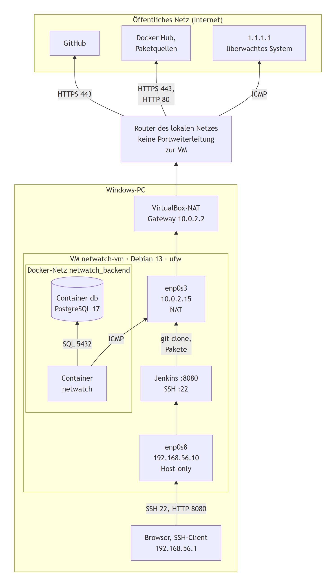
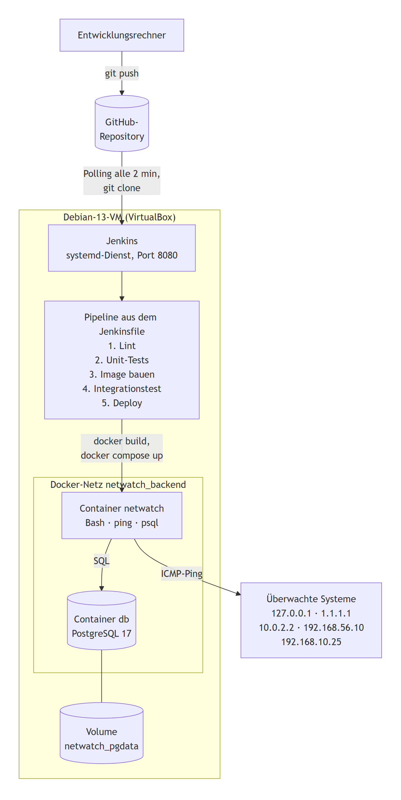
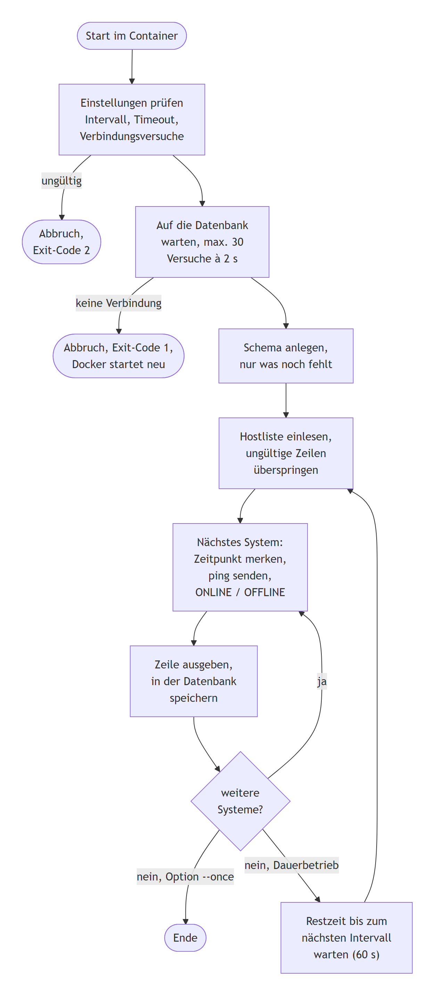
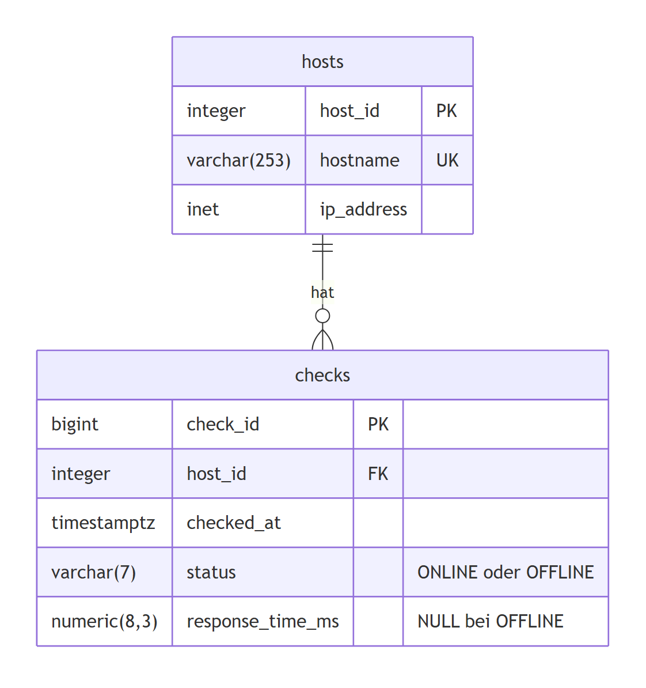

# NetWatch - CI/CD-Umgebung mit GitHub, Jenkins und Docker
Projektdokumentation · Stand 12.10.2026
Repository: <https://github.com/anguishhh/LeeroyJenkinsPipeline> (öffentlich)

---

## 1. Zielsetzung

Ziel des Projekts ist eine lauffähige CI/CD-Umgebung auf einer Linux-VM: Jede Änderung am Quellcode, die auf GitHub eingeht, wird von Jenkins automatisch getestet und nur bei fehlerfreiem Durchlauf als Docker-Container bereitgestellt. Test und Bereitstellung laufen ohne manuellen Eingriff auf dem Server.

Als Anwendung dient **NetWatch**, ein Monitoring-Programm in Bash. Es prüft Server und Netzwerkgeräte im Minutentakt per Ping, erkennt sie als ONLINE oder OFFLINE und speichert die Ergebnisse dauerhaft in einer PostgreSQL-Datenbank. Anwendung und Datenbank laufen in getrennten Containern.

### 1.1 Projektziele

Das Gesamtziel ist in sechs Teilziele zerlegt. Zu jedem Ziel ist festgelegt, womit es umgesetzt wird, woran es gemessen wird und wo der Nachweis steht:

| # | Ziel | Umsetzung | Messkriterium | Nachweis |
|---|---|---|---|---|
| 1 | Jede Codeänderung wird automatisch getestet | Jenkins fragt GitHub alle 2 Minuten nach neuen Commits; die Pipeline enthält drei Teststufen | Ein Push löst ohne weiteres Zutun einen Testlauf aus | Testfall P1: Push 12:20, Build 12:22, von der Pipeline selbst gestartet |
| 2 | Fehlerhafte Versionen werden nicht bereitgestellt | Die Stage *Deploy* steht am Ende der Pipeline und wird nur nach bestandenen Tests erreicht | Ein absichtlich eingebauter Fehler führt zum Abbruch vor der Bereitstellung | Testfälle P2 und P3: Build #4 nach 8,6 s rot in den Unit-Tests, Build #5 schon in der Stage *Lint* nach 1 s rot; kein Deployment |
| 3 | Der laufende Softwarestand ist eindeutig bestimmbar | Image-Tag mit Buildnummer, Commit-Hash als Version im Image | Jede Version trägt Buildnummer und Commit-Hash | Image `netwatch:<Buildnummer>`, Version im Protokoll beim Start |
| 4 | Die Bereitstellung erfolgt ohne Handarbeit auf dem Server | `docker compose up` in der Stage *Deploy* | Nach bestandenen Tests läuft die neue Version ohne manuellen Eingriff | Stage *Deploy*, nachgewiesen in den Builds #3 und #6 |
| 5 | Monitoring-Daten gehen nicht verloren | Datenbank in eigenem Container, Daten in einem benannten Docker-Volume | Daten überstehen Container- und Systemneustarts | Testfälle I10, B2 und B4: 462 → 477 Messungen über den VM-Neustart hinweg |
| 6 | Zugangsdaten stehen nirgends im Quellcode | Jenkins-Credential, Umgebungsvariablen, `.gitignore` | Volltextsuche im Repository findet keine echten Passwörter | Testfall B5; das Produktivpasswort liegt nur im Credential-Speicher von Jenkins |

---

## 2. Planung der Gesamtumgebung

### 2.1 Vorgehen

Die Umgebung wurde in fünf aufeinander aufbauenden Schritten geplant und umgesetzt. Jeder Schritt war für sich prüfbar, bevor der nächste begann:

| Schritt | Inhalt | Prüfkriterium |
|---------|--------|---------------|
| 1 | Linux-VM mit Netzwerk, Benutzern und Absicherung | VM per SSH erreichbar, Internetzugang vorhanden |
| 2 | Git-Repository mit Projektstruktur | Repository geklont, Struktur steht |
| 3 | NetWatch-Skript und Datenbankschema | Prüflauf speichert Ergebnisse |
| 4 | Dockerfile und Docker Compose | Anwendung und Datenbank laufen als getrennte Container |
| 5 | Jenkins mit Pipeline und Trigger | Commit löst Test und Bereitstellung aus |

### 2.2 Anforderungen und gewählte Lösungen

| Technische Anforderung | Umsetzung im Projekt |
|---|---|
| Linux läuft als virtuelle Maschine | Debian 13 „trixie“ in Oracle VirtualBox |
| Quellcode mit Git und GitHub verwaltet | öffentliches Repository `anguishhh/LeeroyJenkinsPipeline` |
| Jenkins verwendet eine Pipeline aus einem Jenkinsfile | `Jenkinsfile` im Repository, Job-Typ „Pipeline script from SCM“ |
| Anwendung läuft als Docker-Container | Image `netwatch:<Buildnummer>` aus eigenem Dockerfile |
| Datenbank als separater Container | offizielles Image `postgres:17` |
| Ergebnisse werden tatsächlich gespeichert | Tabellen `hosts` und `checks`, Nachweis per SQL-Abfrage |
| Pipeline bezieht den Quellcode aus GitHub | `checkout scm` in der Stage *Checkout* |
| Automatisierter Test in der Pipeline | ShellCheck, 14 Unit-Tests, 10 Integrationstests |
| Deployment nur nach erfolgreichem Test | Stage *Deploy* wird nur bei grünen Vorstufen erreicht |
| Keine Zugangsdaten im Quellcode oder Jenkinsfile | Jenkins-Credential, Umgebungsvariablen, `.gitignore` |

### 2.3 Planung der virtuellen Maschine

Alle Dienste laufen auf einer einzigen VM. Sie muss Jenkins, die Image-Builds und bis zu vier Container gleichzeitig tragen: Während des Integrationstests laufen Test-Datenbank und Test-Instanz von NetWatch neben der produktiven Umgebung.

| Parameter | Planung | Begründung |
|---|---|---|
| Hypervisor | Oracle VirtualBox | läuft auf dem Windows-PC, stellt NAT- und Host-only-Netze ohne Zusatzsoftware bereit |
| Betriebssystem | Debian 13 „trixie“, ohne grafische Oberfläche | stabile Server-Distribution; dieselbe Basis wie das Image der Anwendung (`debian:trixie-slim`) |
| Arbeitsspeicher | 8 GB | Jenkins empfiehlt für kleine Teams mindestens 4 GB; dazu kommen PostgreSQL, Docker-Builds und die Testcontainer |
| Prozessorkerne | 6 | Image-Build und Tests laufen neben dem laufenden Monitoring |
| Festplatte | 50 GB, dynamisch wachsend | entspricht der Jenkins-Empfehlung; Platz für Images, die letzten 20 Builds und das Datenbank-Volume |
| Netzwerk | zwei Adapter: NAT und Host-only | trennt Internetzugang und Verwaltung, siehe 2.4 |

Die Einrichtung der VM ist in Abschnitt 5 beschrieben.

### 2.4 Netzplanung: lokales Netz, öffentliches Netz und GitHub

Die Umgebung besteht aus vier Netzzonen. Geplant wurde so, dass aus dem öffentlichen Netz keine Verbindung in die Umgebung hinein möglich ist; nach außen geht nur, was gebraucht wird.

| Zone | Adressbereich | Beteiligte Systeme | Erreichbarkeit |
|---|---|---|---|
| Öffentliches Netz (Internet) | öffentliche Adressen | GitHub, Docker Hub, Paketquellen von Debian, Docker und Jenkins, öffentliche Zielsysteme wie 1.1.1.1 | wird von der VM nur ausgehend angesprochen |
| NAT-Netz von VirtualBox | 10.0.2.0/24 | VM (`enp0s3`, 10.0.2.15), virtuelles Gateway 10.0.2.2 | Weg der VM ins Internet; von außen nicht ansprechbar |
| Host-only-Netz | 192.168.56.0/24 | Windows-PC (192.168.56.1), VM (`enp0s8`, 192.168.56.10) | nur zwischen PC und VM; einziger Zugang zu SSH und Jenkins |
| Docker-Netz `netwatch_backend` | 172.18.0.0/16, von Docker vergeben | Container `netwatch` und `db` | nur innerhalb der VM |



Über diese Zonen laufen genau die folgenden Verbindungen:

| Verbindung | Richtung | Protokoll / Port | Zweck |
|---|---|---|---|
| Windows-PC → VM | eingehend, nur Host-only-Netz | SSH 22/tcp, HTTP 8080/tcp | Administration und Jenkins-Oberfläche |
| VM → GitHub | ausgehend ins öffentliche Netz | HTTPS 443/tcp | Abfrage auf neue Commits, Klonen des Repositorys |
| VM → Docker Hub, Debian- und Jenkins-Paketquellen | ausgehend ins öffentliche Netz | HTTPS 443/tcp, HTTP 80/tcp | Basis-Images, Pakete, Updates |
| Container `netwatch` → überwachte Systeme | ausgehend, lokal und öffentlich | ICMP | die eigentliche Erreichbarkeitsprüfung |
| Container `netwatch` → Container `db` | nur innerhalb des Docker-Netzes | PostgreSQL 5432/tcp | Speichern der Ergebnisse |
| Öffentliches Netz → VM | **nicht möglich** | - | die VM hat keine öffentliche Adresse und keine Portweiterleitung |

Daraus ergeben sich drei Planungsentscheidungen:

- **Zwei Netzwerkkarten mit getrennten Aufgaben:** Der NAT-Adapter stellt den Internetzugang bereit, der Host-only-Adapter die Verwaltung. Dadurch ist die Verwaltung auch dann erreichbar, wenn das Internet ausfällt, und sie ist vom öffentlichen Netz getrennt.
- **GitHub als einziger Berührungspunkt mit dem öffentlichen Netz im Projektablauf:** Der Quellcode liegt öffentlich auf GitHub, die Verbindung dorthin baut aber immer die VM auf. Genau deshalb fällt die Wahl auf Polling: Ein Webhook würde eine Verbindung von außen erfordern, die in dieser Netzumgebung weder möglich noch erwünscht ist.
- **Datenbank ohne Netzzugang von außen:** Sie veröffentlicht keinen Port auf der VM, ist also selbst aus dem Host-only-Netz nicht erreichbar.

### 2.5 Begründete Entscheidungen

**Öffentliches GitHub-Repository:** Jenkins klont das Repository ohne Zugangsdaten. Auf der VM liegt damit kein GitHub-Token, das abhandenkommen oder ablaufen könnte. Im Gegenzug ist alles im Repository für jeden lesbar; Zugangsdaten dürfen deshalb unter keinen Umständen hineingeraten - die Maßnahmen dazu stehen in den Abschnitten 6.4 und 8.4. Bei einem privaten Repository wäre ein GitHub-Token mit reinem Leserecht als Jenkins-Credential nötig.

**Jenkins direkt auf der VM statt als Container:** Die Pipeline startet selbst Container (`docker build`, `docker compose`). Läuft Jenkins direkt auf dem System, nutzt es dafür einfach den vorhandenen Docker-Dienst. Als Container bräuchte Jenkins zusätzlich die Docker-CLI im Image und entweder den eingebundenen Docker-Socket oder „Docker in Docker“ in einem privilegierten Container. Außerdem stimmen so die Pfade: Die Pipeline bindet ihr Arbeitsverzeichnis in Testcontainer ein (`-v "$WORKSPACE:/code"`), was bei einem containerisierten Jenkins zu Pfadkonflikten zwischen Host und Container führt. Jenkins läuft als systemd-Dienst und startet nach einem Neustart der VM automatisch mit. Nachteil: Java und Jenkins liegen direkt auf dem System, Updates sind aufwändiger als ein Image-Austausch. Die nötige Mitgliedschaft des Benutzers `jenkins` in der Gruppe `docker` entspricht faktisch Root-Rechten - das gilt beim eingebundenen Docker-Socket allerdings genauso und ist daher kein Argument für die Container-Variante.

**Polling statt Webhook:**

| | Polling (gewählt) | Webhook |
|---|---|---|
| Prinzip | Jenkins fragt regelmäßig bei GitHub nach neuen Commits | GitHub schickt bei jedem Push eine Anfrage an Jenkins |
| Verzögerung | bis zum nächsten Intervall, hier höchstens 2 Minuten | wenige Sekunden |
| Last | Anfragen auch dann, wenn sich nichts geändert hat | nur bei tatsächlichen Änderungen |
| Netzwerk | nur ausgehende Verbindungen nötig | Jenkins muss aus dem Internet erreichbar sein |
| Sicherheit | kein offener Port nach außen | öffentlicher Endpunkt, Absicherung per Secret und HTTPS nötig |

Die VM steht hinter dem NAT von VirtualBox und dem Router des lokalen Netzes und besitzt keine öffentliche Adresse; eine Portweiterleitung bis zur VM gibt es nicht. Ein Webhook von GitHub könnte sie nicht erreichen. Gewählt wurde deshalb Polling mit `pollSCM('H/2 * * * *')`. In einer Umgebung mit erreichbarem Server wäre der Webhook vorzuziehen, weil er schneller reagiert und keine Leerlauf-Abfragen erzeugt. Als Mittelweg ließe sich ein Weiterleitungsdienst wie smee.io einsetzen, der nur eine ausgehende Verbindung benötigt.

**PostgreSQL als Datenbank:** Die Datentypen `inet` für IP-Adressen und `timestamptz` für Zeitstempel mit Zeitzone passen unmittelbar zu den Monitoring-Daten, und `inet` prüft die Gültigkeit einer Adresse bereits auf Datenbankebene. Entscheidend war außerdem, dass das Kommandozeilenwerkzeug `psql` Werte als Variablen übergeben bekommen kann (`:'name'`) und selbst korrekt maskiert. Ein Bash-Skript hat keine Datenbankbibliothek mit vorbereiteten Anweisungen; über diesen Weg ist der Zugriff trotzdem gegen SQL-Injection abgesichert.

**Trennung von Anwendung und Datenbank in zwei Container:** Jeder Container hat eine Aufgabe. Die Datenbank kann unabhängig von der Anwendung neu gestartet oder aktualisiert werden, und die Anwendung lässt sich bei jedem Commit austauschen, ohne die Daten zu berühren.

---

## 3. Architektur



Die beiden Container liegen in einem eigenen Docker-Netz (`netwatch_backend`). Die Datenbank veröffentlicht bewusst keinen Port auf der VM: Sie ist ausschließlich für den NetWatch-Container erreichbar. Zugriffe zur Kontrolle erfolgen über `docker exec`.

### Komponenten im Überblick

| Komponente | Version | Aufgabe |
|---|---|---|
| Oracle VirtualBox | Hypervisor | stellt die virtuelle Maschine bereit |
| Debian GNU/Linux 13 „trixie“ | Kernel 6.12.111 | Betriebssystem der VM |
| Docker CE | 29.8.2 | Container-Laufzeit |
| Docker Compose Plugin | 5.6.0 | startet Anwendung und Datenbank gemeinsam |
| Jenkins LTS | 2.580.1 (OpenJDK 21) | Automatisierungsserver, führt die Pipeline aus |
| Git / GitHub | 2.47.3 auf der VM | Versionsverwaltung, Quelle der Pipeline |
| PostgreSQL | 17 (Image `postgres:17`) | speichert die Monitoring-Ergebnisse |
| NetWatch | eigenes Image auf `debian:trixie-slim` | die Monitoring-Anwendung selbst |

### Schnittstellen zwischen den Komponenten

Die Komponenten sind nur über klar festgelegte Schnittstellen miteinander verbunden:

| Von → Nach | Schnittstelle | Was übertragen wird |
|---|---|---|
| Entwicklungsrechner → GitHub | `git push` über HTTPS | Commits mit Quellcode, Dockerfile, Compose-Datei und Jenkinsfile |
| Jenkins → GitHub | Polling und `git clone` über HTTPS | Abfrage auf neue Commits, Quellcode für den Build |
| Jenkins → Docker | Docker-CLI über den Docker-Socket (Gruppe `docker`) | `docker run` für ShellCheck und bats, `docker build`, `docker compose up` |
| Jenkins → Docker Compose | Umgebungsvariablen aus dem Credential `netwatch-db` | Benutzername und Passwort der Datenbank, nur in der Stage *Deploy* |
| Docker → NetWatch und Datenbank | Image, Container, Netz `netwatch_backend`, Volume `pgdata` | Laufzeitumgebung beider Komponenten |
| NetWatch → überwachte Systeme | ICMP Echo Request (`ping`) | Erreichbarkeitsprüfung, Antwortzeit |
| NetWatch → Datenbank | `psql` über TCP 5432 im Docker-Netz, Dienstname `db` | Hostname, IP-Adresse, Zeitpunkt, Status und Antwortzeit jeder Prüfung |
| Datenbank → Volume | Verzeichnis `/var/lib/postgresql/data` | dauerhafte Speicherung aller Daten |

Jenkins steuert damit den gesamten Ablauf, hält aber selbst keine Anwendungsdaten. GitHub ist die einzige Quelle für Code und Pipeline-Definition, Docker die einzige Laufzeitumgebung für Anwendung und Datenbank.

---

## 4. Zusammenspiel der Komponenten

Der folgende Ablauf beschreibt, was nach einer Codeänderung passiert. Er wurde als Testfall P1 nachgewiesen.

1. **Commit und Push:** Eine Änderung am Quellcode wird committet und nach GitHub übertragen. Beispiel aus dem Test: Commit `2e1c752` um 12:19 Uhr, gepusht um 12:20 Uhr.
2. **Erkennung:** Jenkins fragt alle zwei Minuten bei GitHub nach neuen Commits. Um 12:22 Uhr stellt es die Änderung fest und startet Build #3. Auf der Build-Seite steht als Auslöser „Build wurde durch eine SCM-Änderung ausgelöst“ - der Build wurde also nicht von Hand gestartet.
3. **Checkout:** Die Pipeline holt den Stand aus GitHub in ihr Arbeitsverzeichnis und gibt den Commit samt Autor im Protokoll aus.
4. **Statische Analyse:** ShellCheck prüft alle Bash-Skripte auf Fehler und riskante Konstruktionen. Findet es etwas, bricht die Pipeline hier ab.
5. **Unit-Tests:** 14 Tests mit dem Framework bats prüfen die einzelnen Funktionen des Skripts, ohne Netzwerk und ohne Datenbank. Das Ergebnis wird als JUnit-Bericht an Jenkins übergeben und erscheint dort als Testverlauf.
6. **Image bauen:** Erst jetzt entsteht aus dem Dockerfile das Image `netwatch:<Buildnummer>`. Der kurze Commit-Hash wird als Version in das Image geschrieben und beim Start protokolliert.
7. **Integrationstest:** In einem eigenen, temporären Compose-Projekt startet eine Test-Datenbank. NetWatch führt dort einen einzelnen Prüfdurchlauf aus, anschließend liest der Test die Ergebnisse direkt aus der Datenbank. Die Produktivumgebung bleibt unberührt.
8. **Deploy:** Die Stage *Deploy* holt Benutzername und Passwort der Produktivdatenbank aus dem Jenkins-Credential und startet die neue Version mit `docker compose up -d --wait`. Compose ersetzt nur den NetWatch-Container; die Datenbank und ihr Volume bleiben bestehen.
9. **Betrieb:** Der neue Container prüft ab sofort im Minutentakt alle Systeme aus der Hostliste und schreibt die Ergebnisse in die Datenbank.

Schlägt eine Stage fehl, bricht Jenkins sofort ab. Die Stage *Deploy* wird dann nie erreicht, und die zuvor erfolgreich getestete Version läuft unverändert weiter. Das fehlerhafte Image wird in der Nachbearbeitung wieder entfernt.

> Screenshot1

---

## 5. Linux und Virtualisierung

### 5.1 Virtuelle Maschine

| Parameter | Wert |
|---|---|
| Virtualisierung | Oracle VirtualBox |
| Betriebssystem | Debian 13.7 „trixie“, 64 Bit, Start ohne grafische Oberfläche |
| Arbeitsspeicher | 8 GB |
| Prozessorkerne | 6 |
| Festplatte | 50 GB, dynamisch wachsend |
| Hostname | `netwatch-vm` |
| Zeitzone | Europe/Berlin |

Geplant war eine Installation nur mit Standard-Systemwerkzeugen und SSH-Server, denn ein Server braucht keine Desktop-Umgebung, und sie kostet unnötig Ressourcen und Angriffsfläche. Bei der Installation blieb jedoch die vom Debian-Installer vorausgewählte Desktop-Umgebung GNOME aktiviert (Problem 11 in Abschnitt 12). Sie ist inzwischen abgeschaltet: Die VM startet ohne grafische Oberfläche, und die mitinstallierten Dienste für Druck (CUPS) und Netzwerkerkennung (avahi) sind deaktiviert. Die Pakete selbst sind noch vorhanden. Sie zu entfernen hätte auch NetworkManager betroffen, der den NAT-Adapter verwaltet.

### 5.2 Netzwerk

Die VM besitzt zwei Netzwerkkarten mit klar getrennten Aufgaben:

| Schnittstelle | Typ | Adresse | Zweck |
|---|---|---|---|
| `enp0s3` | NAT | 10.0.2.15/24 (DHCP über NetworkManager) | Internetzugang für Paketquellen, GitHub und Docker Hub |
| `enp0s8` | Host-only | 192.168.56.10/24 (statisch) | Verwaltung vom Windows-PC: SSH und Jenkins-Oberfläche |
| `docker0` | Bridge | 172.17.0.0/16 | Standardnetz von Docker, von NetWatch nicht genutzt |
| `netwatch_backend` | Bridge | 172.18.0.0/16 | internes Netz der Container `netwatch` und `db` |

Der NAT-Adapter bezieht Adresse, DNS-Server und Standard-Gateway (10.0.2.2) per DHCP; das übernimmt NetworkManager. Der Host-only-Adapter erhält eine feste Adresse, damit SSH-Zugang und Jenkins-URL dauerhaft gleich bleiben. Er bekommt bewusst **kein** Standard-Gateway: Der gesamte ausgehende Verkehr läuft über den NAT-Adapter. Seine Konfiguration steht in `/etc/network/interfaces`, NetworkManager lässt ihn deshalb unverwaltet:

```
auto enp0s8
iface enp0s8 inet static
    address 192.168.56.10/24
```

### 5.3 Benutzer und Rechte

| Benutzer | Art | Rechte und Zweck |
|---|---|---|
| `a` | Mensch | Administration über SSH, Mitglied von `sudo` und `docker` |
| `jenkins` | Dienstkonto, automatisch angelegt | führt die Pipeline aus, Mitglied von `docker` |
| `netwatch` | Dienstkonto im Container | führt das Monitoring-Skript ohne Root-Rechte aus |
| `postgres` | Dienstkonto im Datenbank-Container | Datenbankserver |
| `root` | Systemkonto | Anmeldung gesperrt (`passwd -S root` meldet `L`); Verwaltung ausschließlich über `sudo` |

Die Mitgliedschaft in der Gruppe `docker` erlaubt den Zugriff auf den Docker-Socket und entspricht damit faktisch Root-Rechten auf der VM. Für `jenkins` ist das unvermeidbar, weil die Pipeline Container bauen und starten muss. Für einen produktiven Einsatz wäre „rootless Docker“ oder ein eigener Build-Agent die sauberere Lösung; für einen Prototyp auf einer isolierten VM ist das Risiko vertretbar und bewusst in Kauf genommen.

Im Container läuft die Anwendung dagegen als unprivilegierter Benutzer `netwatch`. Ping funktioniert trotzdem, weil Docker unprivilegierte ICMP-Sockets standardmäßig erlaubt.

### 5.4 Installierte Pakete

Für das Projekt wurden folgende Pakete installiert:

| Paket | Version | Wofür |
|---|---|---|
| `openssh-server` | Debian 13 | Fernwartung der VM |
| `git` | 2.47.3 | Versionsverwaltung, Quelle der Pipeline |
| `curl`, `ca-certificates` | Debian 13 | Herunterladen und Prüfen der Paketquellen-Schlüssel |
| `ufw` | Debian 13 | Firewall |
| `unattended-upgrades` | Debian 13 | automatische Sicherheitsupdates |
| `docker-ce`, `docker-ce-cli`, `containerd.io` | 29.8.2 / 2.3.6 | Container-Laufzeit |
| `docker-buildx-plugin`, `docker-compose-plugin` | 0.37.1 / 5.6.0 | Images bauen, Dienste gemeinsam starten |
| `fontconfig`, `openjdk-21-jre` | 21.0.12.1 | Laufzeitumgebung für Jenkins |
| `jenkins` | 2.580.1 (LTS) | Automatisierungsserver |

Docker und Jenkins stammen aus den offiziellen Herstellerquellen, die mit eigenem Signaturschlüssel eingebunden wurden. Das ist aktueller als die Debian-Pakete und war bei Jenkins auch nötig, weil die Distribution keine aktuelle LTS-Fassung mitbringt.

### 5.5 Installierte Dienste

| Dienst | Port | Erreichbar von |
|---|---|---|
| OpenSSH | 22/tcp | nur aus 192.168.56.0/24 |
| Jenkins | 8080/tcp | nur aus 192.168.56.0/24 |
| Docker und containerd | - | lokal |
| Container `db` (PostgreSQL) | 5432/tcp | nur im internen Docker-Netz |
| Container `netwatch` | - | keine eingehenden Verbindungen |

Außer SSH (22) und Jenkins (8080) wartet auf der VM kein weiterer TCP-Port auf Verbindungen (`ss -tln`). NetworkManager läuft als lokaler Dienst und verwaltet den NAT-Adapter.

### 5.6 Absicherung

- **Firewall (ufw):** Standardregel „alles eingehende verbieten, alles ausgehende erlauben“. Freigegeben sind nur SSH und Jenkins, und zwar ausschließlich aus dem Host-only-Netz.
- **Keine veröffentlichten Container-Ports:** Von Docker veröffentlichte Ports umgehen ufw. Deshalb veröffentlicht die Datenbank keinen Port; sie ist nur containerintern erreichbar.
- **SSH nur mit Schlüssel:** Die Anmeldung erfolgt mit einem ed25519-Schlüsselpaar, das auf dem Windows-PC erzeugt wurde. Der private Schlüssel verlässt den PC nicht, auf der VM liegt nur der öffentliche Teil. Die Passwort-Anmeldung ist abgeschaltet (`PasswordAuthentication no`), ebenso die Anmeldung als `root`. Damit laufen Angriffe mit geratenen Passwörtern ins Leere.
- **Automatische Sicherheitsupdates** über `unattended-upgrades`.
- **Keine unnötigen Dienste:** Die VM startet ohne grafische Oberfläche; die mitinstallierten Dienste gdm, CUPS und avahi sind abgeschaltet.

> Screenshot2

---

## 6. Git und GitHub

### 6.1 Aufbau des Repositorys

```
bin/netwatch.sh           Monitoring-Skript
bin/netwatch-report.sh    Konsolenanzeige der Ergebnisse
config/hosts.conf         Liste der überwachten Systeme
config/hosts.test.conf    feste Hostliste für den Integrationstest
sql/schema.sql            Tabellen, Index und View
tests/netwatch.bats       Unit-Tests
tests/integration.sh      Integrationstest gegen eine echte Datenbank
Dockerfile                Image der Anwendung
compose.yaml              Anwendung und Datenbank
Jenkinsfile               Definition der Pipeline
docs/                     Dokumentation (dieser Text, VM-Einrichtung, Testkonzept,
                          Diagramme und Screenshots)
.env.example              Vorlage für Zugangsdaten, ohne echte Werte
.gitignore .gitattributes .dockerignore
```

Die Gliederung trennt Programm (`bin/`), Konfiguration (`config/`), Datenbank (`sql/`), Tests (`tests/`) und Dokumentation (`docs/`). Die Definition der Infrastruktur liegt bewusst im selben Repository: Dockerfile, Compose-Datei und Jenkinsfile werden damit genauso versioniert und überprüft wie der Programmcode.

### 6.2 Einsatz von Git

Die Arbeit erfolgt in thematisch abgegrenzten Commits mit aussagekräftigen Nachrichten, zum Beispiel:

```
Projektgrundlage: .gitignore und .gitattributes
NetWatch-Skript mit Datenbankanbindung
Unit-Tests für NetWatch (bats)
Docker-Image und Compose-Setup
Jenkins-Pipeline mit Integrationstest
Dokumentation: README, VM-Einrichtung, Testkonzept
Testfall P1: eigene VM in die Hostliste aufgenommen
Testfall P2: absichtlicher Fehler, ONLINE und OFFLINE vertauscht
Revert "Testfall P2: absichtlicher Fehler, ONLINE und OFFLINE vertauscht"
Pipeline: alte Testberichte vor jedem Lauf entfernen
```

Die absichtlich fehlerhaften Commits der Testfälle P2 und P3 wurden nicht gelöscht, sondern mit `git revert` zurückgenommen. Dadurch bleibt in der Historie nachvollziehbar, dass der Fehler eingebaut, von der Pipeline erkannt und anschließend korrigiert wurde.

### 6.3 Umgang mit Zeilenenden

Entwickelt wird unter Windows, ausgeführt wird unter Linux. Eine Datei mit Windows-Zeilenenden bricht im Container mit der Meldung `$'\r': command not found` ab. Die Datei `.gitattributes` legt deshalb mit `* text=auto eol=lf` fest, dass alle Textdateien mit Unix-Zeilenenden gespeichert werden. Ergänzend verarbeitet das Skript auch eine Hostliste mit Windows-Zeilenenden korrekt - das wird von einem eigenen Unit-Test abgedeckt.

### 6.4 Keine Passwörter im Repository

Die mitgelieferte `.gitignore` wurde durch eine projektbezogene Fassung ersetzt. Sie schließt `.env`, `*.env`, `secrets/`, Schlüsseldateien, Testergebnisse und Editor-Dateien aus. Versioniert ist nur die Vorlage `.env.example` mit dem Platzhalter `bitte-aendern`.

Nachweis (Testfall B5): Eine Volltextsuche im gesamten Repository findet ausschließlich Variablennamen wie `POSTGRES_PASSWORD`, den Platzhalter der Vorlage und das zufällig erzeugte Einmal-Passwort des Integrationstests. Das Passwort der Produktivdatenbank existiert weder im Repository noch als Datei auf der VM, sondern ausschließlich im Credential-Speicher von Jenkins.

---

## 7. Die Anwendung NetWatch

### 7.1 Überblick

NetWatch ist ein Bash-Skript, das dauerhaft im Container `netwatch` läuft. Es beantwortet für jedes eingetragene System im Minutentakt zwei Fragen: Ist das System gerade erreichbar, und wie schnell antwortet es? Jedes Ergebnis wird sofort im Protokoll ausgegeben und in der Datenbank gespeichert, sodass auch der Verlauf später abrufbar ist.

| Baustein | Inhalt |
|---|---|
| Eingabe | Hostliste `config/hosts.conf` und Einstellungen über Umgebungsvariablen |
| Verarbeitung | ein ICMP-Ping je System, Bewertung als ONLINE oder OFFLINE, Antwortzeit in Millisekunden |
| Ausgabe | eine Tabellenzeile je Prüfung im Protokoll des Containers |
| Speicherung | Hostname, IP-Adresse, Prüfzeitpunkt, Status und Antwortzeit in PostgreSQL |
| Auswertung | Konsolenanwendung `netwatch-report.sh` |

NetWatch kennt zwei Betriebsarten: den Dauerbetrieb im Container und mit der Option `--once` einen einzelnen Prüfdurchlauf, den der Integrationstest der Pipeline verwendet.

### 7.2 Ablauf



1. **Start:** NetWatch prüft zuerst seine Einstellungen. Ein ungültiger Wert, etwa ein Intervall von 0, führt sofort zum Abbruch mit einer klaren Meldung.
2. **Datenbank:** Anwendung und Datenbank starten gemeinsam. NetWatch wartet deshalb, bis die Datenbank Verbindungen annimmt und die Zugangsdaten stimmen. Gelingt das nicht, beendet sich das Skript mit Fehler, und Docker startet den Container automatisch neu.
3. **Schema:** NetWatch legt Tabellen, Index und View an, sofern sie noch nicht existieren. Eine neue Datenbank braucht dadurch keine manuelle Vorbereitung, vorhandene Daten bleiben unverändert.
4. **Prüfdurchlauf:** Die Hostliste wird bei jedem Durchlauf neu gelesen. Für jedes System hält NetWatch den Zeitpunkt fest, sendet einen Ping, gibt das Ergebnis aus und speichert es.
5. **Warten:** Gewartet wird nur die Restzeit bis zum nächsten Intervall, die Dauer der Pings wird also abgezogen. So bleibt der Takt bei einer Minute (Testfall B1).
6. **Beenden:** `docker stop` sendet das Signal SIGTERM. NetWatch beendet sich daraufhin sofort und geordnet, auch mitten in der Wartezeit.

Fällt die Datenbank im laufenden Betrieb aus, meldet NetWatch für jedes System einen Speicherfehler, prüft aber weiter und speichert wieder, sobald die Datenbank zurück ist (Testfall B3).

### 7.3 Erkennung von ONLINE und OFFLINE

Für jedes System sendet NetWatch genau ein Ping-Paket und wartet höchstens zwei Sekunden auf die Antwort (`ping -c 1 -W 2`). Entscheidend ist der Rückgabewert von `ping`:

| Ergebnis von `ping` | Status | Antwortzeit |
|---|---|---|
| Antwort innerhalb des Timeouts, Rückgabewert 0 | ONLINE | aus der Ausgabe gelesen, z. B. `time=0.040 ms` → 0.040 |
| keine Antwort, Ziel nicht erreichbar oder Timeout, Rückgabewert ungleich 0 | OFFLINE | keine (in der Datenbank NULL) |

Ein System im Status OFFLINE ist für NetWatch kein Programmfehler, sondern ein gültiges Messergebnis. Als Fehler gelten nur eine fehlende oder leere Hostliste und Ergebnisse, die nicht gespeichert werden konnten.

Bewusste Vereinfachung: Geht ein einzelnes Paket verloren, gilt das System für diese eine Minute als OFFLINE. Die nächste Prüfung bewertet es neu; im Verlauf ist ein solcher Ausreißer als einzelner Eintrag erkennbar.

### 7.4 Konfiguration

Die Hostliste `config/hosts.conf` ist bewusst einfach aufgebaut, damit sie ohne Spezialwissen gepflegt werden kann:

```
# Format: <hostname> <IPv4-Adresse>
localhost        127.0.0.1
dns-cloudflare   1.1.1.1
vbox-nat-gateway 10.0.2.2
netwatch-vm      192.168.56.10
fileserver01     192.168.10.25
```

Jede Zeile wird beim Einlesen geprüft: der Hostname nach den Regeln für DNS-Namen, die IPv4-Adresse auf vier Oktette von 0 bis 255. Ungültige Zeilen werden mit Warnung und Zeilennummer übersprungen; Kommentare, Leerzeilen und Windows-Zeilenenden stören nicht. Die Hostliste ist Teil des Images. Ein neues System wird deshalb wie jede andere Änderung über Git eingetragen und von der Pipeline getestet und ausgeliefert (Testfall P1).

Alle übrigen Einstellungen kommen aus Umgebungsvariablen, die Docker Compose setzt. Im Skript selbst stehen weder Adressen noch Zugangsdaten:

| Variable | Standard | Bedeutung |
|---|---|---|
| `NETWATCH_INTERVAL` | 60 | Sekunden zwischen zwei Prüfdurchläufen |
| `NETWATCH_PING_TIMEOUT` | 2 | maximale Wartezeit pro Ping in Sekunden |
| `NETWATCH_DB_RETRIES` | 30 | Verbindungsversuche zur Datenbank beim Start |
| `NETWATCH_HOSTS_FILE` | `/app/config/hosts.conf` | Pfad der Hostliste |
| `NETWATCH_SCHEMA_FILE` | `/app/sql/schema.sql` | Pfad des Datenbankschemas |
| `PGHOST`, `PGDATABASE`, `PGUSER`, `PGPASSWORD` | von Compose gesetzt | Verbindung zur Datenbank (Standardvariablen von `psql`) |

### 7.5 Aufbau des Skripts

Das Skript ist in kleine, einzeln prüfbare Funktionen gegliedert. Genau diese Gliederung macht die Unit-Tests möglich:

| Funktion | Aufgabe |
|---|---|
| `is_valid_ipv4`, `is_valid_hostname` | prüfen Einträge der Hostliste auf Gültigkeit |
| `read_hosts` | liest die Hostliste, überspringt Kommentare, Leerzeilen und fehlerhafte Einträge |
| `check_host` | führt den Ping aus und liefert `ONLINE <ms>` oder `OFFLINE` |
| `parse_ping_time` | liest die Antwortzeit aus der Ausgabe von `ping` |
| `print_result` | gibt ein Ergebnis als Tabellenzeile aus |
| `wait_for_db`, `init_schema` | warten auf die Datenbank und legen das Schema an |
| `save_result` | speichert ein Ergebnis über `psql` |
| `run_checks`, `main` | Ablaufsteuerung und Intervall |

Weitere Eigenschaften:

- **Trennung von Daten und Meldungen:** Ergebnisse gehen auf die Standardausgabe, Meldungen der Stufen INFO, WARN und ERROR auf die Fehlerausgabe. Dadurch können Ergebnisse weiterverarbeitet werden, ohne dass Meldungen sie verfälschen.
- **Testbarkeit:** Wird das Skript per `source` eingebunden, startet es nicht, sondern stellt nur seine Funktionen bereit. Die Unit-Tests rufen so jede Funktion einzeln auf und ersetzen den Ping durch eine Testfunktion.
- **Schutz vor SQL-Injection:** Die Werte gehen als `psql`-Variablen in die Abfrage, `psql` maskiert sie selbst. Ein manipulierter Eintrag in der Hostliste kann kein SQL ausführen.
- **Ausführlich kommentiert** in deutscher Sprache, mit Kopfkommentar zu Aufruf, Konfiguration und Rückgabewerten.

### 7.6 Ausgabe

Im laufenden Betrieb schreibt NetWatch jede Prüfung in sein Protokoll:

```
netwatch-vm          192.168.56.10   2026-10-05 12:55:49+0200  ONLINE  0.040 ms
fileserver01         192.168.10.25   2026-10-05 12:55:49+0200  OFFLINE
```

Zusätzlich gibt es die Konsolenanwendung `netwatch-report.sh`, die den aktuellen Status je System und die letzten Prüfungen aus der Datenbank anzeigt:

```
docker exec netwatch-netwatch-1 netwatch-report.sh 10
```

Hinweis: Seit Commit `7d87d84` (gepusht am 05.10.2026 um 13:12 Uhr) rundet `netwatch-report.sh` die Antwortzeit auf zwei statt auf eine Nachkommastelle. Grund: Systeme im eigenen Netz antworten in Bruchteilen einer Millisekunde, und mit nur einer Stelle erschienen Werte unter 0,05 ms als „0.0 ms“, also scheinbar ohne Antwortzeit. Die gespeicherten Werte haben unverändert drei Nachkommastellen, geändert hat sich nur die Anzeige. Die Screenshots in diesem Abschnitt und in Abschnitt 11.3 entstanden vor der Änderung und zeigen im Report deshalb noch eine Nachkommastelle.

> Screenshot3

---

## 8. Datenbank

### 8.1 Datenmodell

Das Modell trennt die überwachten Systeme von den einzelnen Messungen. Ein System hat viele Prüfergebnisse (1:n):



Ohne diese Trennung stünde der Hostname in jeder einzelnen Messung erneut - bei einer Prüfung pro Minute und Host wären das schnell Zehntausende redundante Einträge.

Die Datentypen sind auf die Werte abgestimmt, die NetWatch tatsächlich liefert:

| Spalte | Datentyp | Begründung |
|---|---|---|
| `hosts.host_id` | `integer`, automatisch fortlaufend | Primärschlüssel; über zwei Milliarden mögliche Werte reichen für jede denkbare Zahl überwachter Systeme |
| `hosts.hostname` | `varchar(253)` | 253 Zeichen sind die Höchstlänge eines DNS-Namens; das Skript prüft beim Einlesen dieselbe Grenze |
| `hosts.ip_address` | `inet` | eigener Typ für IP-Adressen: lehnt ungültige Adressen ab und sortiert und vergleicht numerisch statt als Text |
| `checks.check_id` | `bigint`, automatisch fortlaufend | die Messtabelle wächst stetig, je Host um rund 525.000 Zeilen im Jahr; `bigint` schließt einen Überlauf auch bei vielen Hosts aus |
| `checks.host_id` | `integer` | Fremdschlüssel, derselbe Typ wie der referenzierte Schlüssel `hosts.host_id` |
| `checks.checked_at` | `timestamptz` | Zeitpunkt mit Zeitzone; das Skript übergibt ihn mit UTC-Abstand (`+0200`), dadurch bleibt er auch bei der Zeitumstellung eindeutig |
| `checks.status` | `varchar(7)` mit CHECK | nur `ONLINE` oder `OFFLINE` zulässig; in Abfragen direkt lesbar und bei Bedarf leicht um weitere Zustände erweiterbar |
| `checks.response_time_ms` | `numeric(8,3)`, darf NULL sein | exakter Dezimalwert mit drei Nachkommastellen, so wie `ping` die Zeit ausgibt (z. B. `0.034`); Platz bis 99.999,999 ms, bei 2 s Timeout mehr als genug; NULL bei OFFLINE |

### 8.2 Qualitätssicherung in der Datenbank

Das Schema lässt fehlerhafte Daten gar nicht erst zu:

| Regel | Wirkung |
|---|---|
| `ip_address inet` | nur gültige IP-Adressen werden angenommen |
| `status CHECK (… IN ('ONLINE','OFFLINE'))` | kein anderer Status ist möglich |
| `CHECK (status = 'ONLINE' OR response_time_ms IS NULL)` | ein nicht erreichbares System kann keine Antwortzeit haben |
| `hostname UNIQUE` | jedes System existiert genau einmal |
| `REFERENCES hosts … ON DELETE CASCADE` | keine Messungen ohne zugehöriges System |
| Index auf `(host_id, checked_at DESC)` | schnelle Abfrage des letzten Ergebnisses |

Die View `v_latest_status` liefert den jeweils aktuellsten Stand je System und wird von der Konsolenanwendung und den Tests genutzt.

Das Schema wird beim Start der Anwendung automatisch angelegt. Alle Anweisungen sind so formuliert, dass ein erneuter Start vorhandene Daten nicht verändert.

### 8.3 Persistenz

Die Datenbank legt ihre Dateien im benannten Volume `netwatch_pgdata` ab, das unabhängig von den Containern besteht. Nachgewiesen wurde das dreifach: im Integrationstest nach `docker compose down` (I10), nach dem Neustart des Anwendungscontainers (B2) und nach dem Neustart der kompletten VM (B4: 462 Prüfungen davor, 477 danach).

### 8.4 Zugangsdaten

Das Skript enthält keine Zugangsdaten. Es liest ausschließlich die Standardvariablen von `psql` (`PGHOST`, `PGDATABASE`, `PGUSER`, `PGPASSWORD`). Der Weg des Passworts:

```
Jenkins-Credential "netwatch-db"
   → withCredentials in der Stage Deploy (nur dort sichtbar, im Protokoll maskiert)
   → Umgebungsvariable
   → Docker Compose setzt sie im Container
   → psql verwendet sie für die Verbindung
```

Im Integrationstest wird stattdessen bei jedem Lauf ein zufälliges Einmal-Passwort erzeugt, das nirgends gespeichert wird. Für die Arbeit auf einem Entwicklungsrechner dient eine lokale Datei `.env`, die von Git ausgeschlossen ist.

> Screenshot4

---

## 9. Docker

### 9.1 Image der Anwendung

Das Dockerfile baut auf `debian:trixie-slim` auf, also derselben Distribution wie die VM. Es installiert nur drei Pakete: `iputils-ping` für die Prüfung, `postgresql-client` für `psql` und `tzdata` für die korrekte lokale Zeit. Anschließend legt es den unprivilegierten Benutzer `netwatch` an, kopiert Programm, Schema und Konfiguration und setzt die Ausführungsrechte explizit - unter Windows gehen diese beim Commit sonst verloren.

Die Buildnummer und der Commit-Hash werden als Version in das Image übernommen und beim Start protokolliert. Dadurch ist im laufenden Betrieb jederzeit erkennbar, welcher Softwarestand gerade aktiv ist.

Eine `.dockerignore` sorgt dafür, dass weder das `.git`-Verzeichnis noch Dokumentation oder eine eventuell vorhandene `.env` in den Build-Kontext gelangen.

### 9.2 Zusammenspiel über Docker Compose

| Einstellung | Begründung |
|---|---|
| zwei Dienste `netwatch` und `db` | klare Aufgabentrennung, unabhängig austauschbar |
| `depends_on` mit `condition: service_healthy` | NetWatch startet erst, wenn die Datenbank wirklich bereit ist |
| Healthcheck `pg_isready` | prüft die Bereitschaft der Datenbank statt nur den Containerstatus |
| benanntes Volume `pgdata` | Daten überleben Neustart, Update und `docker compose down` |
| eigenes Netz `backend` | Container erreichen sich über den Dienstnamen `db` |
| kein `ports:` bei der Datenbank | von außen nicht erreichbar, auch nicht an der Firewall vorbei |
| `restart: unless-stopped` | beide Container starten nach einem Neustart der VM automatisch |
| `${POSTGRES_PASSWORD:?…}` | fehlt das Passwort, bricht Compose mit klarer Meldung ab |

`docker ps` zeigt beim Container `netwatch-db-1` in der Spalte PORTS trotzdem `5432/tcp` an. Das ist nur der im Image `postgres:17` deklarierte Port. Ein auf der VM veröffentlichter Port erschiene als `0.0.0.0:5432->5432/tcp`.

Der Integrationstest startet dieselbe Compose-Datei unter einem eigenen Projektnamen (`netwatch-test-<Buildnummer>`). Dadurch entstehen eigene Container, ein eigenes Netz und ein eigenes Volume; die Produktivumgebung läuft ungestört weiter. Sichtbar war das während Build #7: Während `netwatch-test-7-db-1` lief, prüfte `netwatch-netwatch-1` mit Version 6 ununterbrochen weiter.

> Screenshot5

---

## 10. Jenkins und die CI/CD-Pipeline

### 10.1 Einrichtung

Jenkins 2.580.1 wurde aus dem offiziellen Jenkins-Repository installiert und läuft als systemd-Dienst unter OpenJDK 21. Der Benutzer `jenkins` wurde in die Gruppe `docker` aufgenommen, damit die Pipeline Images bauen und Container starten kann. Die Oberfläche ist unter `http://192.168.56.10:8080` erreichbar, ausschließlich aus dem Host-only-Netz.

Eingerichtet wurden:

- ein Credential vom Typ „Username with password“ mit der ID `netwatch-db` für die Produktivdatenbank,
- ein Job vom Typ *Pipeline* mit der Definition „Pipeline script from SCM“, der das Jenkinsfile aus dem Branch `main` des GitHub-Repositorys liest.

Damit liegt die gesamte Pipeline-Definition im Repository und nicht in der Jenkins-Konfiguration. Sie ist versioniert, überprüfbar und bei einer Neuinstallation von Jenkins mit wenigen Klicks wiederhergestellt.

> Screenshot6

> Screenshot7

### 10.2 Aufbau der Pipeline

| Stage | Inhalt | Dauer (Build #6) |
|---|---|---|
| Checkout SCM | von Jenkins automatisch: Repository samt Jenkinsfile holen | 0,78 s |
| Checkout | `checkout scm`, Commit im Protokoll ausgeben, alte Testberichte entfernen | 0,86 s |
| Lint | ShellCheck prüft alle Bash-Skripte | 1 s |
| Unit-Tests | 14 bats-Tests, Ergebnis als JUnit-Bericht | 1 s |
| Image bauen | `docker build` mit Commit-Hash als Version | 2 s |
| Integrationstest | Test-Datenbank, Prüflauf, 10 Kontrollen in der Datenbank | 24 s |
| Deploy | neue Version mit Zugangsdaten aus dem Credential starten | 3 s |
| Post Actions | Testbericht an Jenkins übergeben, bei Fehlschlag Image löschen | 0,2 s |

Die Stages zusammen dauern rund 33 Sekunden, der gesamte Build laut Jenkins 37 Sekunden; die Differenz entfällt auf Start und Abschluss des Builds. Das Image entsteht in nur 2 Sekunden, weil Docker die unveränderten Schichten aus dem Cache wiederverwendet. Den größten Anteil hat der Integrationstest, der eine eigene Datenbank startet und wieder entfernt. Weitere Einstellungen:

- **Trigger:** `pollSCM('H/2 * * * *')` - Abfrage alle zwei Minuten.
- **Zeitlimit:** 20 Minuten, damit ein hängender Build nicht dauerhaft blockiert.
- **Keine parallelen Builds**, damit sich zwei Durchläufe nicht gegenseitig die Container wegräumen.
- **Aufbewahrung** der letzten 20 Builds.
- **Nach einem Fehlschlag** wird das eventuell entstandene Image wieder gelöscht, damit keine ungetestete Version im System zurückbleibt.

### 10.3 Teststufen in der Pipeline

Die Tests sind nach Aufwand gestaffelt, sodass einfache Fehler früh und billig auffallen:

1. **ShellCheck** findet Syntax- und Stilfehler in Sekunden, ohne etwas auszuführen.
2. **Unit-Tests** prüfen die Logik der einzelnen Funktionen, ohne Netzwerk und Datenbank. Der Ping wird dabei durch eine Testfunktion ersetzt, sodass beide Fälle - erreichbar und nicht erreichbar - zuverlässig und ohne Wartezeit prüfbar sind.
3. **Integrationstest** prüft das Zusammenspiel aller Teile gegen eine echte PostgreSQL-Datenbank, einschließlich der Fehlerfälle „falsches Passwort“ und „Datenbank nicht erreichbar“.

> Screenshot8

---

## 11. Testkonzept und Ergebnisse

Getestet wurde auf vier Ebenen: automatisierte Unit-Tests (U), automatisierte Integrationstests (I), Tests der Pipeline selbst (P) und Tests des laufenden Betriebs (B). U und I laufen bei jedem Commit automatisch, P und B wurden einmalig von Hand durchgeführt und dokumentiert.

### 11.1 Automatisierte Tests (Nachweis: Build #1 und folgende)

| Nr. | Testfall | Art | Soll | Ist | OK |
|---|---|---|---|---|---|
| U1 | gültige IP-Adressen | positiv | werden akzeptiert | `ok 1` | ✓ |
| U2 | ungültige IP-Adressen (256.1.1.1, 1.2.3, abc) | negativ | werden abgelehnt | `ok 2` | ✓ |
| U3 | Antwortzeit aus ping-Ausgabe lesen | positiv | `time=0.045 ms` → `0.045` | `ok 5-7` | ✓ |
| U4 | Ping erfolgreich (simuliert) | positiv | `ONLINE 12.3` | `ok 8` | ✓ |
| U5 | Ping fehlgeschlagen (simuliert) | negativ | `OFFLINE` | `ok 9` | ✓ |
| U6 | Hostliste mit Kommentaren, Leerzeilen, Windows-Zeilenenden | positiv | nur gültige Einträge | `ok 10, 12` | ✓ |
| U7 | ungültige Einträge, fehlende Datei | negativ | übersprungen bzw. Fehler | `ok 11, 13` | ✓ |
| I1 | Prüfdurchlauf `--once` | positiv | Rückgabewert 0 | `PASS I1` | ✓ |
| I2 | 127.0.0.1 prüfen | positiv | `ONLINE` mit Antwortzeit | `ONLINE`, 0.034 ms | ✓ |
| I4 | 192.0.2.1 (nicht erreichbar) prüfen | negativ | `OFFLINE`, keine Antwortzeit | `OFFLINE`, NULL | ✓ |
| I6 | ungültiger Eintrag 999.1.1.1 | negativ | wird nicht gespeichert | 0 Treffer, genau 2 Messungen | ✓ |
| I8 | falsches Datenbank-Passwort | negativ | Fehler, Rückgabewert ≠ 0 | `password authentication failed` | ✓ |
| I9 | Datenbank gestoppt | negativ | Fehler, Rückgabewert ≠ 0 | `could not translate host name "db"` | ✓ |
| I10 | `docker compose down` und Neustart | positiv | Daten noch vorhanden | 2 von 2 Datensätzen | ✓ |

Als Negativtest dient die Adresse 192.0.2.1. Sie stammt aus dem laut RFC 5737 für Dokumentationszwecke reservierten Bereich und wird im Internet nie geroutet - der Test ist dadurch unabhängig von der jeweiligen Netzumgebung immer aussagekräftig.

### 11.2 Tests der Pipeline (05.10.2026)

| Nr. | Testfall | Soll | Ist | OK |
|---|---|---|---|---|
| P1 | Commit löst Build aus | Start ohne Zutun innerhalb von 2 Minuten, Deploy der neuen Version | Push 12:20, Build #3 um 12:22, „durch eine SCM-Änderung ausgelöst“, danach läuft `netwatch:3` und überwacht den neuen Host | ✓ |
| P2 | fehlerhafter Code wird gestoppt | Abbruch in den Unit-Tests, kein Deploy | Build #4 nach 8,6 s rot, Test „check_host meldet ONLINE …“ fehlgeschlagen, kein Image `netwatch:4`, alte Version lief ununterbrochen weiter | ✓ |
| P3 | Stilfehler wird gestoppt | Abbruch in der Stage *Lint*, kein Deploy | Build #5 rot in *Lint* nach 1 Sekunde (`SC2086`, Rückgabewert 1); alle folgenden Stages übersprungen, kein Image gebaut | ✓ |
| P4 | Korrektur per `git revert` | Pipeline wieder grün | Build #6, 37 s, alle Stages grün, Deploy von `netwatch:6` | ✓ |

P2 ist der zentrale Nachweis für Projektziel 2: Eine fehlerhafte Version darf nicht bereitgestellt werden. Die Pipeline hat den Fehler nicht nur erkannt, sie hat ihn so früh erkannt, dass gar kein Image entstanden ist.

P2 und P3 zeigen zusammen die Staffelung der Teststufen. Der Stilfehler aus P3 fiel bereits nach einer Sekunde in der statischen Analyse auf, noch bevor ein Test ausgeführt oder ein Image gebaut wurde. Der inhaltliche Fehler aus P2 kam erst in den Unit-Tests zum Vorschein. In beiden Fällen blieb die zuvor getestete Version unverändert in Betrieb.

> Screenshot9

> Screenshot10

> Screenshot11

> Screenshot12

### 11.3 Tests des laufenden Betriebs

| Nr. | Testfall | Soll | Ist | OK |
|---|---|---|---|---|
| B1 | regelmäßige Prüfung | etwa eine Messung je Host und Minute | genau 5 Messungen je Host in 5 Minuten, bei allen 5 Hosts | ✓ |
| B2 | Neustart des Anwendungscontainers | läuft weiter, Daten bleiben | Messungen ab 12:54:49 fortgesetzt, bisherige Daten unverändert | ✓ |
| B3 | Ausfall der Datenbank | Fehlermeldung, kein Absturz, danach weiter | Fehler je Host protokolliert, Container blieb „Up“, ab 13:00:49 wieder Messungen gespeichert | ✓ |
| B4 | Neustart der VM | alles startet automatisch, Daten bleiben | Docker und Jenkins aktiv, beide Container automatisch gestartet, 462 → 477 Messungen | ✓ |
| B5 | keine Passwörter im Repository | nur Variablennamen und Platzhalter | bestätigt, `.env` nicht versioniert und auf der VM nicht vorhanden | ✓ |

> Screenshot13

> Screenshot14

---

## 12. Probleme und Abweichungen

Die folgenden Punkte traten während der Umsetzung auf. Sie sind bewusst dokumentiert, weil sie zeigen, wie die jeweilige Ursache gefunden und behoben wurde.

| # | Problem | Ursache | Lösung |
|---|---|---|---|
| 1 | Kein SSH-Zugang nach der Installation | Der SSH-Server war bei der Paketauswahl nicht mit ausgewählt worden | `openssh-server` nachinstalliert, Dienst startet seitdem automatisch |
| 2 | `ping: Temporary failure in name resolution` | Nur der Host-only-Adapter war konfiguriert, der NAT-Adapter und damit DNS und Standard-Gateway fehlten | Den Host-only-Adapter statisch in `/etc/network/interfaces` eingetragen und die VM neu gestartet; seitdem bezieht der NAT-Adapter Adresse, DNS und Standard-Gateway per DHCP über NetworkManager. Vermutlich hatte vorher die DHCP-Zuweisung nicht gegriffen |
| 3 | `apt` lehnte das Jenkins-Repository ab: „The repository is not signed“ | Jenkins hatte den Signaturschlüssel gewechselt; die gängigen Anleitungen nennen noch `jenkins.io-2023.key` | Aktuellen Schlüssel `jenkins.io-2026.key` geladen, Fingerprint mit der Fehlermeldung abgeglichen, Anleitung im Repository korrigiert |
| 4 | SSH-Schlüsselpaar zunächst auf der VM erzeugt | Missverständnis: Der Schlüssel gehört auf den Client, nicht auf den Server | Schlüssel auf dem Windows-PC erzeugt, öffentlichen Teil in `authorized_keys` der VM übertragen |
| 5 | Jenkins-Job hieß zunächst „Pipeline script from SCM“ | Die Bezeichnung der Definitionsart wurde als Jobname eingetragen | Job als `netwatch` neu angelegt und mit einer Beschreibung versehen |
| 6 | Zeitstempel der VM in US-Zeitzone (EDT) | Zeitzone bei der Installation nicht gesetzt | Auf `Europe/Berlin` umgestellt; Jenkins, Systemprotokoll und Datenbank zeigen seitdem dieselbe Zeit |
| 7 | Jenkins konnte das Repository nicht klonen | Das Repository war zunächst privat | Repository veröffentlicht; alternativ wäre ein GitHub-Token mit Leserecht als Jenkins-Credential möglich gewesen |
| 8 | `.gitignore` passte nicht zum Projekt | Bei der Erstellung auf GitHub war die Visual-Studio-Vorlage ausgewählt worden | Durch eine Fassung für dieses Projekt ersetzt (Zugangsdaten, Testergebnisse, Editor-Dateien) |
| 9 | Git verweigerte die Arbeit im Projektordner | Das Repository liegt auf einem Netzlaufwerk, dessen Besitzer Git nicht als vertrauenswürdig einstuft („dubious ownership“) | Den Pfad einmalig als `safe.directory` eingetragen |
| 10 | Build #5 brach in der Stage *Lint* ab, die Build-Seite meldete trotzdem „1 fehlgeschlagener Test“ | Der Arbeitsbereich bleibt zwischen Builds bestehen. Da die Unit-Tests gar nicht liefen, wertete Jenkins am Ende den Testbericht des vorherigen Builds erneut aus | Der Ordner `test-results` wird jetzt direkt nach dem Checkout gelöscht |
| 11 | Beim Abgleich der Dokumentation mit dem laufenden System zeigte sich, dass die VM mit grafischer Oberfläche (GNOME) startete und zusätzlich die Dienste CUPS (Port 631, nur lokal) und avahi liefen | In der Softwareauswahl des Debian-Installers waren „Debian desktop environment“ und „GNOME“ vorausgewählt und wurden nicht abgewählt (vgl. Problem 1) | Start ohne Oberfläche eingestellt (`systemctl set-default multi-user.target`), gdm gestoppt, CUPS und avahi deaktiviert. Die Pakete blieben installiert, weil beim Entfernen auch NetworkManager weggefallen wäre, der den NAT-Adapter verwaltet |

Problem 10 ist ein Nebenergebnis der eigenen Testreihe: Erst der absichtlich herbeigeführte Fehlschlag hat diese Schwäche der Pipeline sichtbar gemacht. Problem 11 zeigt, warum sich der Abgleich von Dokumentation und tatsächlichem System lohnt.

---

## 13. Fazit

Alle sechs Projektziele aus Abschnitt 1 sind erreicht und durch Tests belegt. Eine Codeänderung ist ohne manuelles Zutun nach etwa drei Minuten in Betrieb: höchstens zwei Minuten Wartezeit durch das Polling und 37 Sekunden für Test und Bereitstellung. Fehlerhafte Versionen werden zuverlässig abgefangen, bevor sie ausgeliefert werden - nachgewiesen durch zwei absichtlich eingebaute Fehler. Die Monitoring-Daten überstehen Container-Neustarts, einen Datenbankausfall und den Neustart der gesamten virtuellen Maschine.

Die Tests sind fester Bestandteil der Pipeline und laufen bei jedem Commit (Ziel 1). Das Deployment erfolgt erst nach bestandenen Tests und ohne Handarbeit (Ziele 2 und 4). Jede Version wird als Image mit Buildnummer und Commit-Hash gebaut, sodass der laufende Softwarestand jederzeit eindeutig ist (Ziel 3).

### Mögliche Erweiterungen

- **Webhook statt Polling**, sobald der Server aus dem Internet erreichbar ist, oder über einen Weiterleitungsdienst wie smee.io. Das verkürzt die Reaktionszeit von Minuten auf Sekunden.
- **Eigene Datenbankrolle** für die Anwendung mit Rechten nur auf `hosts` und `checks`, statt des Administratorkontos.
- **Prüfung einzelner Dienste** zusätzlich zum Ping, etwa ein TCP-Verbindungstest auf Port 443.
- **Weboberfläche** als Ergänzung zur Konsolenausgabe.
- **Image-Registry**, damit dieselbe getestete Version auch auf anderen Servern eingesetzt werden kann.
- **Benachrichtigung** bei fehlgeschlagenen Builds oder bei Systemen, die mehrfach hintereinander OFFLINE sind.
- **Rootless Docker oder ein eigener Build-Agent**, um die weitreichenden Rechte der Gruppe `docker` einzuschränken.

---

## 14. Übersicht der Nachweise

| Bewertungskriterium | Wo es in dieser Dokumentation steht |
|---|---|
| **Teil 1** - Planung der Gesamtumgebung inkl. VM, Netzwerk, GitHub, öffentliches Netz | Abschnitt 2: Vorgehen (2.1), Anforderungen (2.2), Planung der VM (2.3), Netzzonen mit Netzdiagramm und allen Verbindungen ins öffentliche Netz (2.4), Entscheidungen zu GitHub, Jenkins, Trigger und Datenbank (2.5) |
| **Teil 1** - Nachvollziehbare Darstellung der Projektziele | Abschnitt 1: technisches Gesamtziel und sechs Teilziele mit Umsetzung, Messkriterium und Nachweis (1.1); Abgleich im Fazit (13) |
| **Teil 1** - Zusammenspiel von GitHub, Jenkins, Docker, NetWatch und Datenbank | Abschnitt 3 (Architekturskizze, Komponenten, Schnittstellen) und Abschnitt 4 (Ablauf nach einem Commit in neun Schritten) |
| **Teil 2** - VM, Netzwerk, Pakete/Dienste, Absicherung | Abschnitt 5, Unterabschnitte 5.1 bis 5.6 |
| **Teil 3** - Repository, Git-Einsatz, Commits, `.gitignore` ohne Passwörter | Abschnitt 6, Unterabschnitte 6.1 bis 6.4 |
| **Teil 4** - Bash-Anwendung, ONLINE/OFFLINE, Ausgabe, Struktur und Kommentare | Abschnitt 7, Unterabschnitte 7.1 bis 7.6 |
| **Teil 5** - Datenbank, Tabellenstruktur, Speicherung, Volume, Zugangsdaten | Abschnitt 8, Unterabschnitte 8.1 bis 8.4 |
| **Teil 6** - Dockerfile, eigener Container, getrennte Datenbank, Compose | Abschnitt 9, Unterabschnitte 9.1 und 9.2 |
| **Teil 7** - Jenkins, Checkout, Jenkinsfile, Stages, Tests, Deploy, Trigger | Abschnitt 10, Unterabschnitte 10.1 bis 10.3 |
| **Teil 8** - Testfälle, positive und negative Tests, Ergebnisse | Abschnitt 11, Unterabschnitte 11.1 bis 11.3 |
